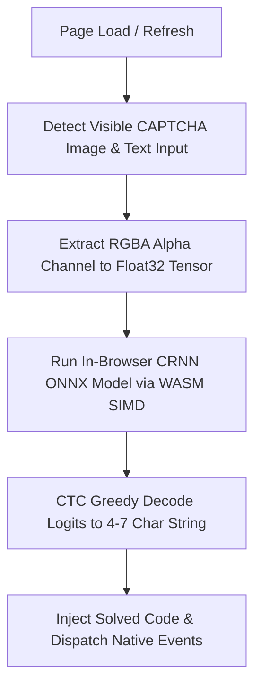

<!-- KLU ERP Auto-Fill | Project documentation -->
<a id="klu-erp-auto-fill"></a>

<div align="center">
  

  <p><strong>On-device CAPTCHA assistance for KL University ERP and the KL Sync Student Portal.</strong></p>
  <p>Recognize CAPTCHA text in-browser with a bundled CRNN model, ONNX Runtime Web v1.16.3, and WebAssembly.</p>

  <p>
    <a href="https://newerp.kluniversity.in/"><strong>Open KLU ERP</strong></a>
    &nbsp; · &nbsp;
    <a href="#installation"><strong>Installation</strong></a>
    &nbsp; · &nbsp;
    <a href="#how-it-works"><strong>How it works</strong></a>
  </p>

  <p>
    <a href="https://developer.chrome.com/docs/extensions/"></a>
    <a href="https://developer.chrome.com/docs/extensions/develop/migrate/what-is-mv3"></a>
    <a href="https://onnxruntime.ai/docs/tutorials/web/"></a>
    
    
  </p>
</div>

---

## At a glance

<table>
  <tr>
    <td width="50%">
      <strong>⚡ Browser-based inference</strong><br>
      The bundled ONNX model runs through ONNX Runtime Web v1.16.3 and WebAssembly SIMD.
    </td>
    <td width="50%">
      <strong>🔄 Refresh-aware</strong><br>
      Tracks CAPTCHA image and input changes, including in-place reloads and element replacement, and schedules recognition for the latest image.
    </td>
  </tr>
  <tr>
    <td width="50%">
      <strong>🎯 Narrow website scope</strong><br>
      The content script is scoped to the KLU ERP and KL Sync production HTTPS origins.
    </td>
    <td width="50%">
      <strong>🧩 Minimal setup</strong><br>
      Load the project directory directly in Chrome; no build step is required.
    </td>
  </tr>
</table>

> **Important:** This extension fills the verification field only. It does not submit the login form, authenticate an account, or guarantee correct recognition. Verify the result before continuing, and use automation only when permitted by university and website policies.

## Contents

- [How it works](#how-it-works)
- [Technology stack](#technology-stack)
- [Project structure](#project-structure)
- [Installation](#installation)
- [Configuration and compatibility](#configuration-and-compatibility)
- [Privacy and security](#privacy-and-security)
- [Troubleshooting](#troubleshooting)
- [Testing and release packaging](#testing-and-release-packaging)
- [Known limitations](#known-limitations)
- [Development](#development)
- [Contributing](#contributing)
- [License](#license)
- [Privacy notes](docs/PRIVACY.md)
- [Security policy](SECURITY.md)
- [Support](SUPPORT.md)
- [Third-party notices](THIRD_PARTY_NOTICES.md)
- [Changelog](CHANGELOG.md)

<a id="how-it-works"></a>

## ⚙️ How It Works

**KLU ERP Auto-Fill** bridges web automation and on-device machine learning directly inside a Content Script. Here is the step-by-step technical pipeline executed locally every time you open the ERP or KL Sync login portal:



### Recognition pipeline

1. **Detect:** Find the visible CAPTCHA image and eligible text verification input on the configured login page using ordered selector priority.
2. **Initialize:** Load and validate the bundled ONNX model metadata (`model/crnn.json`) and create a WASM inference session.
3. **Preprocess:** Draw the CAPTCHA image to an `OffscreenCanvas` (or fallback HTML canvas) and prepare the `[1, 1, 50, 120]` `float32` tensor expected by the model.
4. **Infer:** Run the CRNN model through ONNX Runtime Web v1.16.3 using WebAssembly SIMD.
5. **Decode:** Validate `[1, 30, 27]` finite logits and convert model output into a 4–7 character sequence using greedy CTC decoding.
6. **Fill:** Update the verification field (unless manually edited by the user) and dispatch bubbling `input` and `change` events.
7. **Observe:** Observe relevant DOM mutations, image `load` events, and `src`/`srcset` updates; stale inference is discarded and the latest image is scheduled.

## Technology stack

| Layer | Technology | Purpose |
| --- | --- | --- |
| Extension platform | Chrome Manifest V3 | Declares scripts, permissions, and web-accessible resources |
| Application logic | JavaScript | DOM detection, lifecycle management, and inference orchestration |
| Recognition model | CRNN in ONNX format (opset 14) | Predicts the CAPTCHA character sequence |
| Inference runtime | ONNX Runtime Web v1.16.3 | Loads and executes the model |
| Compute backend | WebAssembly SIMD (WASM) | Runs inference in the browser |
| Sequence decoding | Greedy CTC decoding | Converts `[1, 30, 27]` model logits into text |
| DOM observation | `MutationObserver` | Detects CAPTCHA image source changes and element replacements |

## Project structure

```text
klu-erp-autofill/
├── manifest.json
├── content.js
├── icons/
│   ├── icon16.png
│   ├── icon48.png
│   └── icon128.png
├── model/
│   ├── crnn.onnx
│   └── crnn.json
└── lib/
    ├── ort.min.js
    └── ort-wasm-simd.wasm
```

| File or directory | Description |
| --- | --- |
| `manifest.json` | Extension metadata, content-script configuration, and resource declarations |
| `content.js` | CAPTCHA detection, preprocessing, inference, decoding, and field filling |
| `model/crnn.onnx` | Bundled CRNN recognition model (`input` `[batch, 1, 50, 120]` → `logits` `[batch, 30, 27]`) |
| `model/crnn.json` | Model metadata, including input dimensions, alphabet, and CTC blank index |
| `lib/ort.min.js` | ONNX Runtime Web v1.16.3 JavaScript runtime |
| `lib/*.wasm` | WebAssembly SIMD runtime binary |
| `icons/` | Chrome extension icons |
| `assets/readme-banner.svg` | Custom repository README banner |

## Installation

### 1. Download the project

Clone the repository:

```bash
git clone https://github.com/tejaswin-amara/klu-erp-autofill.git
cd klu-erp-autofill
```

Or select **Code → Download ZIP** on GitHub and extract the archive.

### 2. Open Chrome's extension manager

Visit:

```text
chrome://extensions
```

Enable **Developer mode**.

### 3. Load the extension

1. Select **Load unpacked**.
2. Choose the project folder containing `manifest.json`.
3. Confirm that Chrome displays the extension without an error.

**Keep the folder intact.** The model, runtime, WebAssembly assets, icons, and banner use paths within the project.

### 4. Use it with KL Sync

The same extension also supports the KL Sync Student Portal at [https://klhb.vercel.app](https://klhb.vercel.app). Install or reload version **1.0.4 or newer**, open the KL Sync login page, and wait for the recognition result to populate the security-code field. The extension uses the same refresh-aware, on-device CRNN pipeline and does not submit the login form.

Review the suggested code and complete the separate browser-verification widget and login action yourself. If the extension is not installed, the normal manual CAPTCHA input remains available.

### 5. Test on the ERP page

1. Open [KLU ERP](https://newerp.kluniversity.in/) or [KL Sync](https://klhb.vercel.app/).
2. Ensure the extension is enabled.
3. Reload the tab.
4. Check whether the verification field is populated.
5. Review the recognized text before submitting the form.

## Configuration and compatibility

| Setting | Current implementation |
| --- | --- |
| Target URLs | `https://newerp.kluniversity.in/*` and `https://klhb.vercel.app/*` |
| Extension format | Chrome Manifest V3 |
| Model file | `model/crnn.onnx` |
| Model metadata | `model/crnn.json` |
| Input dimensions | `120 × 50`, as specified in metadata and verified against the ONNX graph |
| Inference runtime | ONNX Runtime Web v1.16.3 |
| Execution backend | WebAssembly SIMD |
| Refresh handling | Observes the CAPTCHA image's `load` event and `src`/`srcset` attributes |

The metadata defines the model's recognition alphabet and CTC blank index (`blank_idx: 0`). Changes to the ERP or KL Sync page structure, CAPTCHA design, or model preprocessing may require code or model updates.

## Privacy and security

The recognition pipeline uses the model and runtime bundled with the extension and does not require a separate remote OCR backend. This does **not** mean the ERP or KL Sync websites themselves operate offline: normal website communication still occurs.

- **Console logging:** The current content script writes caught runtime errors to the browser console. It does not explicitly log the recognized string. Error details may still contain technical information, so redact console output before sharing it.
- **Credentials:** The extension is intended to fill the verification field, not to collect or manage account credentials. Review the source before installing or distributing a modified build.
- **Scope:** The manifest grants content-script execution only to `newerp.kluniversity.in` and the production `klhb.vercel.app` host. Review `manifest.json` before adding any other origin.
- **Accuracy:** Recognition can be incorrect. Check the result before submitting.
- **Responsible use:** CAPTCHA is an anti-automation control. Use this project only where authorized by the institution and the website's applicable policies.

For more detail, see the [privacy notes](docs/PRIVACY.md) and [security policy](SECURITY.md).

## Troubleshooting

<details>
<summary><strong>The verification field is not populated</strong></summary>

- Confirm that you are on [KLU ERP](https://newerp.kluniversity.in/) or the production [KL Sync](https://klhb.vercel.app/) login page.
- Ensure the extension is enabled.
- Reload the extension at `chrome://extensions`, then reload the login tab.
- Check that the model and runtime assets exist at the expected paths.
- Inspect Chrome DevTools Console for messages prefixed with `[KLU-Captcha]`.
- Confirm that the page's current image and input elements match the selectors in `content.js`.

</details>

<details>
<summary><strong>The model or WASM runtime fails to load</strong></summary>

- Verify that `model/crnn.onnx` and `model/crnn.json` exist.
- Check that the files under `lib/` have not been renamed or removed.
- Confirm that the paths in `manifest.json` match the files on disk.
- Use an up-to-date Chrome or Chromium-based browser and inspect the exact console error.

</details>

<details>
<summary><strong>The recognized text is incorrect</strong></summary>

Recognition accuracy is not guaranteed. It depends on the CAPTCHA image, the model, and compatibility between the page image and model preprocessing. Verify the text before submitting; if recognition fails, clear or edit the field manually or refresh the CAPTCHA image.

</details>

<details>
<summary><strong>Changes to the source are not appearing</strong></summary>

1. Save your edits.
2. Open `chrome://extensions`.
3. Click **Reload** on the extension.
4. Reload the login tab.

</details>

## Testing and release packaging

The repository includes dependency-free structural, binary-graph, and VM/WASM behavioral checks plus a standard-library Python ZIP packager. These checks validate the extension manifest, packaged file references, ONNX binary graph contract (`input` `[batch, 1, 50, 120]` → `logits` `[batch, 30, 27]`), end-to-end WASM inference with `lib/ort.min.js`, documentation links/fragments, synthetic DOM lifecycle behavior, package integrity, and manual-submission safeguards.

Requirements: Node.js 20 or newer and Python 3.10 or newer.

Run the checks:

```bash
npm test
npm run test:package
npm run check
```

Build a reproducible release archive (the output ZIP contains extension files and relevant notices, plus a generated `CHECKSUMS.sha256`):

```bash
python scripts/package_extension.py --output dist/klu-erp-autofill.zip
```

The release archive excludes repository-only files such as `.gitignore`, test sources, packaging scripts, and CI configuration. The script also writes a SHA-256 sidecar for the completed ZIP.

## Known limitations

While the ONNX graph signature (`[batch, 1, 50, 120]` → `[batch, 30, 27]`) and WASM runtime execution are verified by automated tests and headless Chromium smoke tests, the repository does not include a held-out labeled recognition benchmark or external training dataset license documentation. Treat recognition as fallible, verify the value manually, and use the extension only where the institution and service permit it.

## Development

1. Clone the repository.
2. Inspect `manifest.json` for extension configuration and target URL scope.
3. Review `content.js` for element detection, preprocessing, inference, decoding, and field updates.
4. Keep the model metadata aligned with the model's expected input and output.
5. Reload the extension and login tab after changes.
6. Test model loading, missing page elements, recognition failures, and CAPTCHA refresh handling.

The extension itself does not require a bundling step. Repository checks and release packaging use the npm scripts and Python utility documented above; these tools are not required to load the unpacked extension.

## Contributing

Contributions that improve reliability, maintainability, and transparency are welcome. Read the [contribution guidelines](CONTRIBUTING.md) before opening a pull request. Community participation is governed by the [Code of Conduct](CODE_OF_CONDUCT.md); use the [GitHub issue tracker](https://github.com/tejaswin-amara/klu-erp-autofill/issues/new/choose) for bug reports and feature requests.

Potential areas for improvement:

- More robust detection of page elements.
- Clearer error handling and diagnostics.
- Removal of sensitive information from debug output.
- Compatibility checks for model inputs and outputs.
- Reproducible tests and clearer setup instructions.

Keep changes focused, test them against the intended environment, and document new dependencies or permissions.

## Author

**Tejaswin Amara**

- GitHub: [@tejaswin-amara](https://github.com/tejaswin-amara)
- Repository: [klu-erp-autofill](https://github.com/tejaswin-amara/klu-erp-autofill)

<a id="license"></a>

## License and legal notice

The original project code and documentation authored for this repository are licensed under the [Apache License 2.0](LICENSE). It permits use, modification, and redistribution subject to its terms, and includes warranty and limitation-of-liability language **to the extent permitted by applicable law**. It cannot guarantee immunity from legal claims. Third-party libraries and model assets may be subject to separate terms; review [THIRD_PARTY_NOTICES.md](THIRD_PARTY_NOTICES.md) and confirm you have the rights to license every included asset before redistributing it.

---

<div align="center">
  <sub>Built with JavaScript, ONNX Runtime Web, and WebAssembly.</sub><br>
  <sub><a href="#klu-erp-auto-fill">Back to top ↑</a></sub>
</div>
